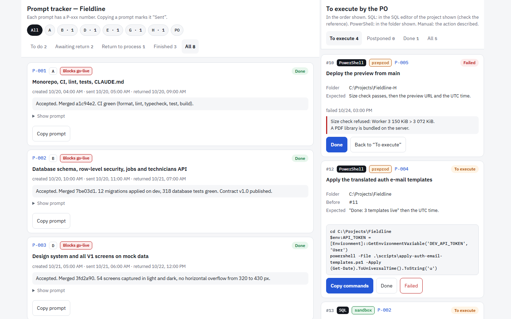
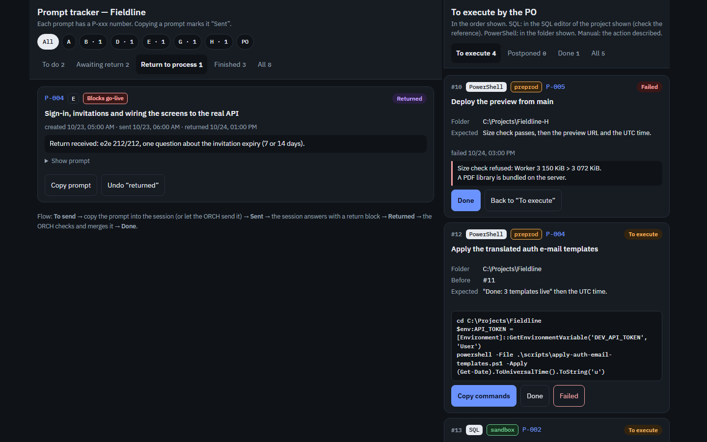
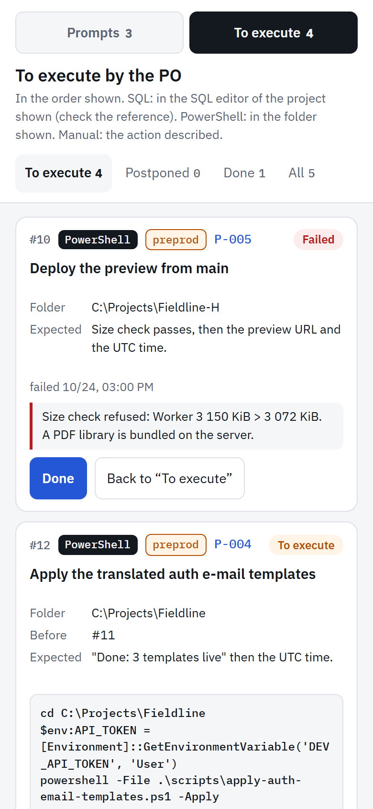

# orch-kit: run a project with several Claude Code sessions

A method proven on a real project (a web app with a backend, AI receipt scanning, a landing page and deployment)
to have **several Claude Code sessions work in parallel**, coordinated by an **ORCH** session, while a human **PO**
keeps the decisions.

## How it works

- **ORCH**: splits the work into numbered prompts (`P-001`, follow-ups `P-001-C2`) and writes each one in full in a
  tracker. It checks every return itself (diff, secrets, merge conflicts, database migrations, live site), merges,
  and only brings decisions to the PO.
- **Specialized sessions** (A foundations, B backend, D design, E integration, H deployment…): each one works in
  its own git worktree and branch, inside its own scope. They answer in a common return format and never merge.
- **PO**: opens and closes the sessions, runs the backend scripts (unless the dev ones are delegated), decides on
  production, money, public texts and anything irreversible, and keeps the secrets and accounts.
  A **delegation matrix** written in the project's CLAUDE.md defines what the ORCH may do on its own.
- **Tracker**: a claude.ai artifact with three views: "Prompts" (to send → sent → returned → done), "To execute"
  (the PO's numbered steps, each with its expected result) and "In progress" (what is running, what is waiting for
  the PO, what comes next, and a dated log).
- **Direct communication**: on the same machine, the ORCH reaches the other sessions (`ListAgents`, `SendMessage`),
  sends ordinary prompts and receives returns without any copy-paste.

## The tracker

A shared claude.ai page, on desktop and mobile, light and dark. Screenshots from a fictional project
("Fieldline", a scheduling app for field technicians).



| Prompts to process (dark mode) | The PO's steps on mobile |
| --- | --- |
|  |  |

Each prompt card shows its session, its go-live impact, its status and the ORCH's note after checking the return.
Each PO step shows its type (SQL, PowerShell, manual), its environment, the commands to copy, the expected result,
and the result pasted back, including failures.

## Contents

```
.claude-plugin/              plugin and marketplace manifests
skills/orchestration-multi-sessions/
  SKILL.md                   the method (roles, checks, delegation, tracker, communication, design)
  templates/                 CLAUDE-orchestration.md, PROMPT.md, RETURN.md, MEMORY.md, BACKLOG.md
  templates/hooks/           optional guard: risk zones, PreToolUse hook, settings snippet
  tracker/index.html         the tracker page in French, to publish as a claude.ai artifact (db and user capabilities)
  tracker/index.en.html      the same tracker in English
GUIDE-PO.md                  the PO guide (roles, getting started, daily routine, delegation, tips)
GUIDE-PO.fr.md               the same PO guide in French
commands/
  orch-init.md               /orch-init: set up the method on a new or existing project
  orch-status.md             /orch-status: status of sessions, worktrees and tracker
```

The skill, templates, commands and PO guide are in English; a French PO guide is in `GUIDE-PO.fr.md`. The tracker
exists in English (`index.en.html`) and French (`index.html`). Claude answers in the user's language.

## Installation

From GitHub:

```powershell
claude plugin marketplace add Eva-Technology-Services/orch-kit
claude plugin install orch-kit@orch-kit --scope user
```

From a local folder:

```powershell
claude plugin marketplace add C:\path\to\orch-kit
claude plugin install orch-kit@orch-kit --scope user
```

Installing the plugin runs nothing: it contains text, one HTML page and an **optional** guard script. That script
runs only in a project where `/orch-init` installs it, after you approve it (see "Catching drift" below).

## Getting started

1. Open Claude Code at the root of your project and type `/orch-init <Project name>`.
2. Approve or adjust the proposed sessions and delegation matrix.
3. Open one Claude Code session per letter in its worktree and give it its prompt from the tracker, or let the ORCH
   send it directly if the delegation allows it.
4. Type `/orch-status` at any time.

## Catching drift while it happens

A task can change risk in the middle: a session starts on a plain endpoint and drifts toward authentication or the
database. Checking the diff at delivery is too late for that, so the kit adds three layers:

1. **Declared risk zones**: `.claude/risk-zones.json` lists risky paths (migrations, auth, security headers,
   payments, deployment, environment files). Each prompt says which zones the session may touch.
2. **Immediate alert**: a session that needs another zone stops and messages the ORCH (file, zone, why) before
   editing. The ORCH grants it, refuses it, or brings it to the PO.
3. **Hard stop**: a small PreToolUse hook (`guard-risk-zones.mjs`, Node, no dependency, no network) asks for human
   approval on any edit in a zone the session's worktree is not cleared for, and tells the session to alert the
   ORCH. The clearance lives in each worktree's `.claude/risk-allow.local.json`, written by the ORCH.

The diff check at delivery stays, as the last line of defense.

## Lessons learned

- Check every return yourself; a minimal integration fix at merge time is reported, never hidden.
- Only one session writes database migrations at a time.
- Secrets live in the user's environment variables, never displayed or written down.
- On a shared machine, check free memory before heavy runs and prefer targeted end-to-end tests.
- Design quality: critique the screenshots, use vetted design skills, and explore two directions on two pilot
  screens before rolling out.
- Install a third-party skill only after reading all its files.

## Author and license

Designed by Abderrahim Akkour, Eva Technology Services. MIT license (see `LICENSE`).
